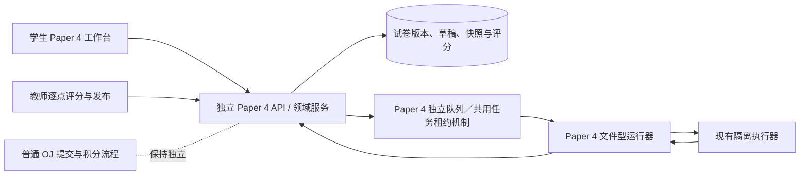

# 9618 Paper 4 编程实践评测设计草案

状态：首要使用场景已确认是**校内练习与模拟考试**；实现细节仍为供讨论的草案，尚未批准实施。本文以用户提供的 2025 年 9618/41 试卷、评分细则、考生文件包、`evidence.doc` 模板，以及已有交互原型为分析样本；原型和其说明只作参考，不构成产品要求。本轮没有修改判题、数据库或页面代码。

## 结论与定位

可以在现有 OJ 旁建立 **Paper 4 实践评测**：复用登录、班级与课程分发、编辑器界面、计时基础设施、任务队列和隔离执行器；将试卷内容、阶段作答、文件产物、评分细则和成绩保存在独立模型中。它首先服务于校内练习和模拟考试。自动运行结果提供可核查的评分建议，最终 75 分按评分点由教师确认。未经单独验证离线考场、监考及证据交付条件，不将其称作符合 Cambridge 正式考试要求的系统。

这份样卷共三题、75 分：环形队列 20 分，文本文件分类 25 分，面向对象二叉树 30 分。试卷要求在若干小题完成时保留当时的代码和运行截图，`evidence.doc` 有 22 处对应位置。仅保存每道大题最后一份程序，会丢失可得分的中间状态。第二题依赖一份 72 行的 `TheData.txt`，并向六份颜色文件写入内容；每次运行都必须从原始文件重新建立工作区。

## 与普通 OJ 的边界

| 可共用的能力 | Paper 4 需要新增的能力 |
| --- | --- |
| 身份与班级授权、课程入口、限时活动的服务端时钟 | 私有试卷包、考生附件、评分细则的版本和权限 |
| 编辑器、题干与运行结果组件 | 大题共用代码文件、小题阅读导航、服务端自动保存、阶段快照 |
| 异步任务租约、隔离沙箱、节点健康与容量控制 | 全新文件工作区、产物回收、针对类/函数/文件的测试适配器 |
| 审计、成绩发布和教师工作区的通用框架 | 逐评分点证据、人工复核、整卷成绩冻结与发布 |

现有 `problem_versions` 表达单道标准输入输出题或函数题，`submissions` 保存一份代码，判题器按测试权重给出 0–100 分。现有 `judge_tasks` 也只接收普通提交和参考解答验证任务。Paper 4 使用独立的 `paper4_*` 数据、API 与任务队列，复用租约、重试、心跳和沙箱执行的成熟机制；普通题目继续走原有路径。Paper 4 不触发普通 AC、首次 AC 积分、全校排行榜或已有作业成绩计算。独立算法小题将来可以另制为普通 OJ 练习，但其 AC 不能冒充整卷分数。

概念数据分为六组：试卷及不可变版本（题面、候选文件、测试与评分细则）；分发活动（对象、时间与反馈策略）；学生作答和带修订号的草稿文件；按阶段冻结的证据快照；隔离运行及回收产物；逐点评分、复核与成绩发布。PDF、初始文件、生成产物与证据放在权限受控的文件存储中，数据库保存清单、哈希、所有者和版本；存储与数据库应一同纳入备份、保留及恢复验证。试卷发布、开始作答、阶段留证、提交冻结、评分确认和成绩发布是不同事件，均须记录服务端时间与操作者。

## 试卷制作与发布

1. 教师建立草稿，上传题面 PDF、考生可见的初始文件，以及教师专用评分细则。导入器只解包经检查的文件，拒绝路径穿越、链接、超额大小或异常压缩比；题面、评分细则与文件清单各自记录哈希和版本。不能把评分细则、参考答案或隐藏测试下发给学生。
2. 教师在编辑器中标注大题、小题、分值、需要保留的阶段代码与截图位置，配置允许的语言、指定文件名、运行入口、初始文件、允许回收的输出文件和测试适配器。原 PDF 可始终打开核对；裁切显示只是阅读辅助，不能代替可访问的原文。
3. 教师按评分点建立规则：自动可验证的行为、需检查的源码结构、需证据的操作、需人工判断的实现。每点有分值上限、依赖条件、自动检查说明和人工评分指引；总分与原卷 75 分核对。教师先用参考实现及故意错误实现试跑公开和隐藏用例，检查评分点是否误判，再发布不可变的试卷版本。
4. 发布到指定课程、班级或选定学生；可选无时限练习或限时模拟。发布后内容修订产生新版本，已开始的作答继续绑定原版本；历史成绩不被后续编辑改写。发布与完成后的教师复核分别审计。

首期建议只做 **Python 版改编练习**，界面明确标注这一点。原考试允许 Python、Java、Visual Basic；系统现有的 C++、JavaScript 支持不代表它们符合这份试卷的语言要求。Java 和 Visual Basic 应在各自隔离执行、文件行为及评分适配器验证后再加入。

## 学生作答与证据

工作台可沿用原型中较有用的三栏关系：左侧大题导航，中间原卷题干与小题，右侧当前大题的代码、运行输出、工作文件和证据。**按大题维护程序文件，按小题记录阶段快照**；切换小题只换阅读位置，不清空或复制代码。学生可以运行、查看自己生成的文件，并在题目要求的节点保存“此刻代码＋本次运行记录＋选定的输出或截图”。

进入下一小题时，系统先自动保存并形成该阶段的代码检查点；若该阶段要求运行截图而尚无可信运行记录，则提示学生补齐，但允许继续编写，避免意外阻断考试。学生可以回到前一小题补交证据，教师能看见各次检查点和补交时间。系统生成的运行记录不应伪装成考生截屏；若需按原卷形式交付，学生须在导出前预览并确认对应证据。

草稿应由服务端自动保存并反馈保存状态，带修订号防止两个标签页互相覆盖；刷新或断线后可恢复。阶段证据一经保存不可原地覆盖，只能补交新版本。正式提交冻结整卷代码、文件清单和证据快照，记录服务端时间、试卷版本与内容哈希。限时结束时冻结最后一次成功保存的版本，并清楚告知学生；浏览器本地缓存只作为断线恢复辅助。教师只看到有权限的学生与试卷。

针对样卷，第一题要保留初始化、入队、主程序、出队及最终运行等阶段；第二题要保留读取、分类、写文件和主流程；第三题要保留 `Node` 的构造器、访问器/设置器、`Tree` 构造器、插入、递归遍历等阶段。不同试卷的阶段由题目配置定义，不能写死三题或固定 `(a)` 到 `(e)`。原型中的演示运行返回固定参考输出，生成文件也并非由学生代码产生，因此只能借鉴交互布局，不能复用其“判题”逻辑。

## 运行与评分

每次运行在全新、无网络、有限时和内存的隔离环境中开始：仅复制该试卷版本允许的输入文件，执行学生代码，捕获退出状态、标准输出/错误及允许名单内的生成文件。回收产物时限制名称、路径、大小、数量和类型，拒绝链接与越界文件。API 使用应用数据库角色，异步工作进程使用独立的工作角色；实际执行学生代码的沙箱不持有任何数据库凭据，API/Web 进程也不执行学生代码。隐藏用例和参考答案只在受控评分路径中使用。

样卷需要比原题示例更有区分度的测试：第一题覆盖队列满、空和指针回绕；第二题覆盖非固定行数、不同颜色分布、文件末尾换行与重新运行不重复追加；第三题覆盖空树、左右分支、重复值按题意落入右侧，以及递归中序输出。测试适配器应允许原题规定的函数/类和合理的等价实现；若考生程序结构使自动测试无法安全调用，标记“待教师判读”，不判 0 分或系统错误。测试适配器自身须作为试卷版本的一部分固定并测试。

成绩页面分开显示三种概念：**运行/隐藏测试结果**、**逐点暂定得分**、**教师确认后的正式得分**。系统对客观行为和可信运行记录给出证据与建议，不以单次输出决定所有分值。构造器、递归实现、异常处理、阶段性要求、截图对应性及可接受的替代写法需要人工确认或抽检。评分细则第二题 2(a) 列出八项说明但此小题最多 7 分，计分必须按小题上限和细则规则封顶，不能直接相加布尔检查。教师可逐点调整并写原因；确认时冻结评分版本，发布后更正须保留前值、操作者和原因。

整卷可采用“自动预评＋教师复核”的练习模式；如果学校希望高度自动化，须逐评分点实测误判率，并保留人工复核入口。题目与证据只对相应学生、授课教师和授权管理员可见。整卷 75 分是课程/活动成绩，不兑换普通题目 AC 奖励，也不进入全校积分榜。

## 实施顺序与验收门槛

1. **规格样卷**：先将 9618/41 的题干、附件、阶段、评分点与测试计划录为草稿，由教师核对 20/25/30 分和所有证据位置。无真实学生作答或积分变化。
2. **Python 实践闭环**：实现独立自动保存、阶段快照、全新文件沙箱、三题的公开/隐藏测试与可信输出/文件浏览。用正确解、典型错误解、恶意路径/大文件、重复运行和断线恢复检验。原 OJ 的 Python/C++/JavaScript 判题回归必须通过。
3. **评分闭环**：加入逐点评分建议、教师复核、75 分汇总、成绩发布和审计。以多份不同风格的解答与评分细则双人对照，记录误判并修正规则；验证并发提交、截止时刻、版本冻结及教师权限。
4. **证据交付与正式考试评估**：若未来要接近原考试工作流，再实现 `evidence.doc` 格式导出并核对截图、代码位置与可读性；离线考场、考务保密、允许语言和正式提交渠道需另行评估，不能因本练习系统能运行就视为满足正式考试条件。

验收时特别检查：任何 Paper 4 运行或发布均不能修改普通 OJ 的提交、AC 状态、奖励积分和排行榜；每次第二题运行产生的六份文件只来自本次学生程序；无证据的阶段不被自动当作满分；系统故障不被记为学生错误或 0 分。

## 已确认场景与待定选项

- 已确认首要场景为校内练习与模拟考试；首期按该边界设计与验收，不承载 Cambridge 正式考试。
- 学校是否要求首期就导出与原模板对应的 `evidence.doc`，还是先用平台内的不可变证据记录供教师评分？
- 教师发布练习时，学生应看到逐测试反馈，还是只看到运行输出、待教师发布成绩后再见详细反馈？限时模拟宜将隐藏测试及评分细则保密至结束后。

资料来源：用户提供的 `9618_s25_qp_41.pdf`、`9618_s25_ms_41.pdf`、考生文件包、`evidence.doc` 和交互原型；正式考试要求另参考 [Cambridge 2024–2025 syllabus](https://www.cambridgeinternational.org/Images/636089-2024-2025-syllabus.pdf) 与 [Cambridge practical test instructions](https://www.cambridgeinternational.org/Images/670892-cambridge-international-as-a-level-computer-science-9618-practical-test-instructions.pdf)。
